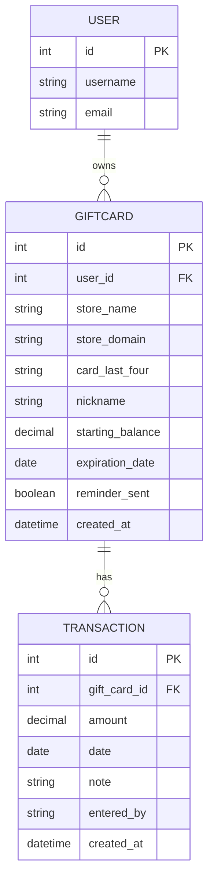

# GFiles: Gift Card Tracker

GFiles keeps track of your gift cards in one place: the balance left on each card, when it expires, and what you spent it on. It emails you before a card expires and shows each store's logo.

Built as a full-stack capstone project for Code Platoon.

  
  

## Features

- Sign up and log in with token authentication. Cards and purchases are private to their owner.
- Add, view, edit, and delete gift cards. Django checks every field and sends back clear error messages.
- Log, edit, and delete purchases on a card. The balance is calculated from the purchases, and a purchase that is more than the balance is rejected.
- A Dashboard with search (by store, nickname, or the last 4 digits of a card), filter chips (all, expiring soon, used up or expired), sorting, and a summary of the card count and total balance.
- Grid view and list view. The app is responsive.
- Status labels on each card: Expiring soon (within 30 days), Expired, and Used up.
- Expiry reminders by email, sent with the Resend API. Each card gets one reminder. A button on the Dashboard triggers them for the demo. See the Roadmap for the scheduled version.
- Store search with logos from the Brandfetch API. A store that has no logo shows its first letter instead.

## Tech stack

| Part | Technology |
| --- | --- |
| Frontend | React (Vite) and Material UI v7 |
| Backend | Django REST Framework with token authentication |
| Database | PostgreSQL 16 |
| Web server | Nginx, serving the React build and forwarding `/api/` to Django |
| Containers | Docker and Docker Compose |
| Hosting | AWS EC2, with the images pulled from Docker Hub |
| Third-party APIs | Resend (expiry emails) and Brandfetch (store logos) |

## Data model

There are two models of mine, plus Django's built-in `User`. A user owns many gift cards, and a gift card has many transactions (shown in the app as purchases), and deleting a parent deletes its children. The balance is never stored: it is the starting balance minus the purchases.

## Getting started

### Prerequisites

| Tool | Needed for | Version I used |
| --- | --- | --- |
| Git | Cloning the repo | Any recent version |
| Docker with Docker Compose v2 | The PostgreSQL database (the `docker compose` command) | Docker 29 |
| Python 3 and pip | The Django backend | Python 3.12 |
| Node.js and npm | The React frontend | Node 22 or newer |

You also need two free accounts for the third-party APIs:

- **[Resend](https://resend.com)**, for an API key. [Here is how to create one](https://resend.com/docs/create-an-api-key). A key with sending access is enough. Without it, the reminder button does not work.
- **[Brandfetch](https://developers.brandfetch.com/register)**, for a client ID. After you sign up, you find it in the [Developer Portal](https://developers.brandfetch.com). The [Brand Search API](https://docs.brandfetch.com/brand-search-api/overview) is free. Without it, there are no store logos, and cards show their first letter.

I developed on macOS.

<strong>API</strong>

Every address starts with `/api/v1/`. Everything except signup and login needs the header `Authorization: Token <your token>`, and cards and purchases are private to their owner.

| Resource | Create | Read | Update | Delete |
| --- | --- | --- | --- | --- |
| Gift cards | `POST /cards/` | `GET /cards/` and `GET /cards/<id>/` | `PUT /cards/<id>/` | `DELETE /cards/<id>/` |
| Purchases | `POST /cards/<id>/transactions/` | Part of the card's detail | `PUT /cards/<id>/transactions/<id>/` | `DELETE /cards/<id>/transactions/<id>/` |

Also: signup and login (`POST /accounts/signup` and `POST /accounts/get-token`), the reminder email (`POST /cards/reminders/`), and the store search (`GET /cards/brand-search/?name=`).

