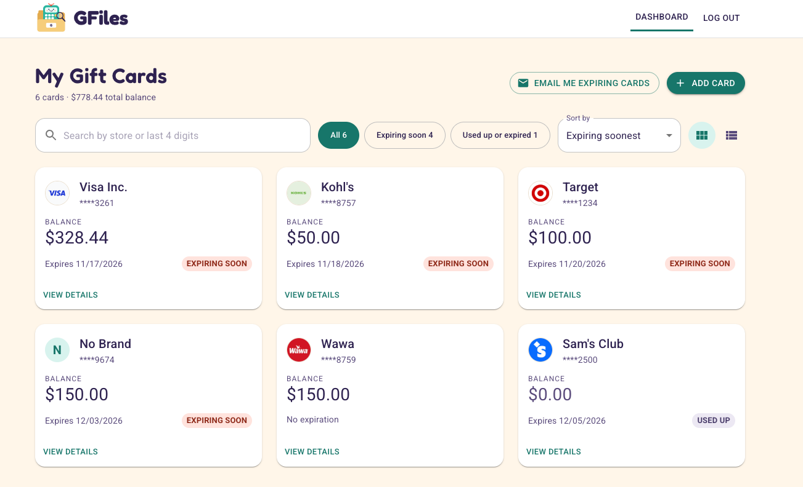
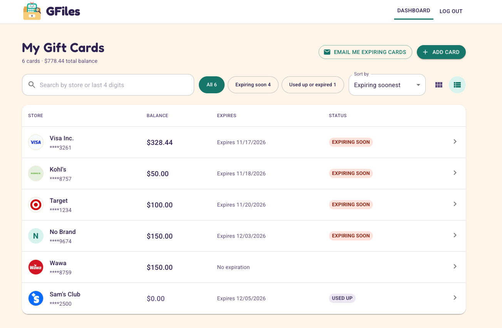
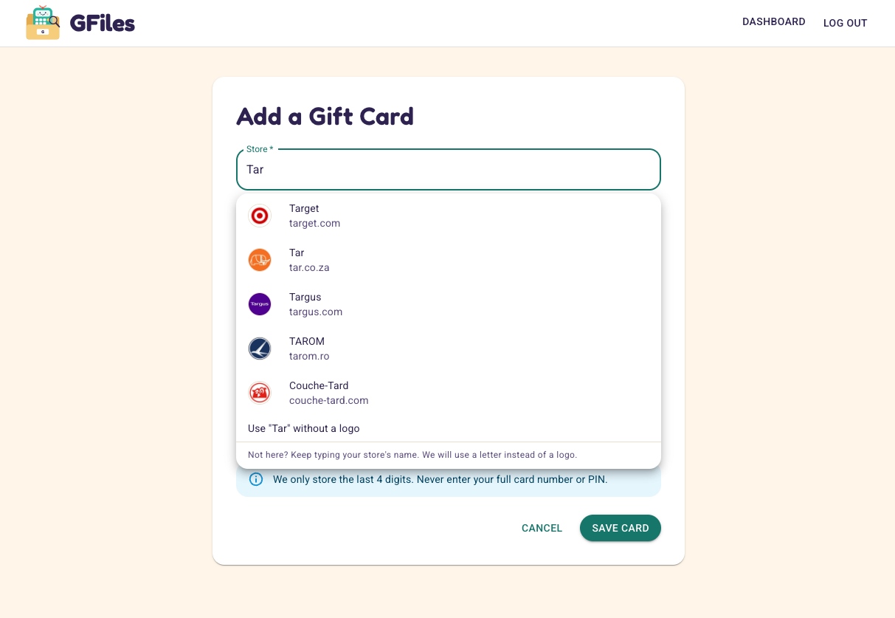
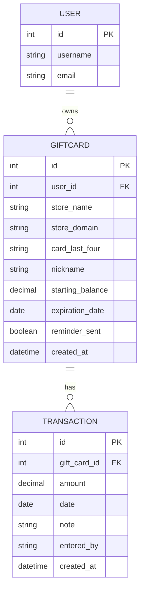

# GFiles: Gift Card Tracker

GFiles keeps track of your gift cards in one place: the balance left on each card, when it expires, and what you spent it on. It emails you before a card expires and shows each store's logo.

Built as a full-stack capstone project for Code Platoon.




<p>
  
  
</p>


## Features

- Sign up and log in with token authentication. Cards and purchases are private to their owner.
- Add, view, edit, and delete gift cards. Django checks every field and sends back clear error messages.
- Log, edit, and delete purchases on a card. The balance is calculated from the purchases, and a purchase that is more than the balance is rejected.
- A Dashboard with search (by store, nickname, or the last 4 digits of a card), filter chips (all, expiring soon, used up or expired), sorting, and a summary of the card count and total balance.
- Grid view and list view. The app is responsive.
- Status labels on each card: Expiring soon (within 30 days), Expired, and Used up.
- Expiry reminders by email, sent with the Resend API. Each card gets one reminder. A button on the Dashboard triggers them for the demo. See the Roadmap for the scheduled version.
- Store search with logos from the Brandfetch API. A store that has no logo shows its first letter instead.

## Tech stack

| Part | Technology |
| --- | --- |
| Frontend | React (Vite) and Material UI v7 |
| Backend | Django REST Framework with token authentication |
| Database | PostgreSQL 16 |
| Web server | Nginx, serving the React build and forwarding `/api/` to Django |
| Containers | Docker and Docker Compose |
| Hosting | AWS EC2, with the images pulled from Docker Hub |
| Third-party APIs | Resend (expiry emails) and Brandfetch (store logos) |

## Data model

There are two models of mine, plus Django's built-in `User`. A user owns many gift cards, and a gift card has many transactions (shown in the app as purchases), and deleting a parent deletes its children. The balance is never stored: it is the starting balance minus the purchases.


## API

Every address starts with `/api/v1/`. Everything except signup and login needs the header `Authorization: Token <your token>`, and cards and purchases are private to their owner.

| Resource | Create | Read | Update | Delete |
| --- | --- | --- | --- | --- |
| Gift cards | `POST /cards/` | `GET /cards/` and `GET /cards/<id>/` | `PUT /cards/<id>/` | `DELETE /cards/<id>/` |
| Purchases | `POST /cards/<id>/transactions/` | Part of the card's detail | `PUT /cards/<id>/transactions/<id>/` | `DELETE /cards/<id>/transactions/<id>/` |

Also: signup and login (`POST /accounts/signup` and `POST /accounts/get-token`), the reminder email (`POST /cards/reminders/`), and the store search (`GET /cards/brand-search/?name=`).


## Getting started

### Prerequisites

| Tool | Needed for | Version I used |
| --- | --- | --- |
| Git | Cloning the repo | Any recent version |
| Docker with Docker Compose v2 | The PostgreSQL database (the `docker compose` command) | Docker 29 |
| Python 3 and pip | The Django backend | Python 3.12 |
| Node.js and npm | The React frontend | Node 22 or newer |

You also need two free accounts for the third-party APIs:

- **[Resend](https://resend.com)**, for an API key. [Here is how to create one](https://resend.com/docs/create-an-api-key). A key with sending access is enough. Without it, the reminder button does not work.
- **[Brandfetch](https://developers.brandfetch.com/register)**, for a client ID. After you sign up, you find it in the [Developer Portal](https://developers.brandfetch.com). The [Brand Search API](https://docs.brandfetch.com/brand-search-api/overview) is free. Without it, there are no store logos, and cards show their first letter.


I developed on macOS.

### 1. Clone the repo and set up your `.env`

The `.env` file holds your secrets and is never committed.

```
git clone https://github.com/SuGardner18/giftcard-tracker.git
cd giftcard-tracker
cp .env.example .env
```

Open `.env` and set these four. Keep the defaults from `.env.example` for the rest.

| Setting | What to put |
| --- | --- |
| `DJANGO_SECRET_KEY` | Generate one with python3 -c "import secrets; print(secrets.token_urlsafe(50))" and paste the result|
| `POSTGRES_PASSWORD` | A password of your choice |
| `RESEND_API_KEY` | Your Resend API key, from the [Resend dashboard](https://resend.com/docs/create-an-api-key) |
| `BRANDFETCH_CLIENT_ID` | Your Brandfetch client ID, from the [Developer Portal](https://developers.brandfetch.com). It is public by design |

Resend's test sender only delivers to the email address on your own Resend account, so sign up in the app with that email to receive reminders.

### 2. Start the database

From the repo root:

```
docker compose up -d db
```


### 3. Run Django

In a terminal:

```
cd backend
python3 -m venv venv
source venv/bin/activate
pip install -r requirements.txt
python manage.py migrate
python manage.py runserver
```

### 4. Run React

In a second terminal:

```
cd frontend
cp .env.example .env
npm install
npm run dev
```

Open http://localhost:5173 and sign up.

### Run the tests

With the database container running and your virtual environment active (`source venv/bin/activate`), from the `backend` folder:

```
python manage.py test
```

There are 65 tests. The tests for Resend and Brandfetch use `@patch`, so they never call the real services.

To stop the database, run `docker compose down` from the repo root. Your data stays in a Docker volume, so don't add `-v`.


<details>
<summary><strong>Deployment</strong></summary>

The app runs on an AWS EC2 server with Docker Compose.

- The images for the API and the frontend are built for the server's x86 chip with `DOCKER_DEFAULT_PLATFORM=linux/amd64 docker compose build`, pushed to Docker Hub, and pulled on the server. 
- Only port 80 is open to the internet. The API and the database are reachable only from inside the server.
- Every service has `restart: unless-stopped`, and an Elastic IP gives the server a fixed address, so the stack comes back by itself after a reboot.
- The server has its own `.env`, with a production secret key, `DJANGO_DEBUG=false`, and its address in `DJANGO_ALLOWED_HOSTS`.

</details>

## Project notes

<details>
<summary><strong>Roadmap</strong></summary>

These are the things I would build next. The reminder button on the Dashboard is there for the demo. The goal is a scheduled script that sends the reminders on its own, so nobody has to click anything.

- **Scheduled reminders for every user.** A Django management command that runs the same reminder logic as the button, run once a day by cron. Resend's test sender only reaches my own email, so a verified sending domain would let it email any user.
- **Folders for stores with many cards.** Cards from the same store would file into one folder, with a card count and a total balance, so a full Dashboard stays clean.
- **Tests on every pull request.** A GitHub Actions workflow that runs the 65 backend tests and blocks a merge if they fail.
- **HTTPS.** A domain and a reverse proxy, so passwords are never sent in plain text.

</details>

<details>
<summary><strong>Engineering notes</strong></summary>

- **Design first, then small changes.** I designed the screens in a Material UI mockup before building them, then built them as short feature branches, one change each, merged through pull requests with merge commits, so the history tells the story of the build.
- **Tests** 65 backend tests cover the models, their validators, and the API. The calls to Resend and Brandfetch are mocked with `@patch`, so the tests never depend on an outside service.
- **Failures degrade gracefully.** If Brandfetch is down or has no logo, the form shows no suggestions, the store name saves as plain text, and the card shows its first letter.
- **AI Usage.** I used Claude as a coding assistant to organize my work and write code more efficiently.

</details>
